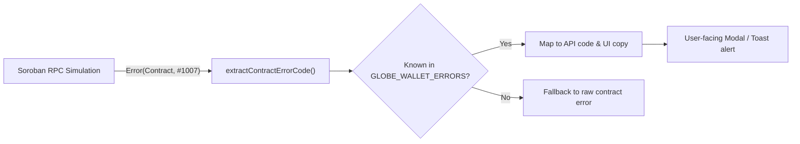

# Contract Error Codes and UI Copy Specification

## Overview

Soroban smart contract errors are emitted as numeric contract errors: `Error(Contract, #N)`.
To deliver an accessible and reliable user experience, the frontend and API layers must not expose raw numeric codes or internal stack traces to users. Instead, each error discriminant maps to:
1. A strongly-typed Rust variant in [`contracts/globe-wallet/src/lib.rs`](../contracts/globe-wallet/src/lib.rs)
2. A numeric discriminant (1001..1038)
3. A stable, machine-readable API code (e.g. `SPEND_LIMIT_EXCEEDED`)
4. Clear, localized UI copy explaining the issue and recovery action to the user

## Error Translation Flow

## Error Mapping Matrix

| Code | Variant | API Code | UI Message (User-Facing) | Cause & Recovery Action |
|:---|:---|:---|:---|:---|
| 1001 | `AlreadyInitialized` | `ALREADY_INITIALIZED` | This wallet contract is already initialized. | Attempted to call `initialize` on an already active contract. No action needed. |
| 1002 | `NotInitialized` | `NOT_INITIALIZED` | This wallet contract has not been initialized yet. | Contract has no admin configured. Initialize with deployer key. |
| 1003 | `Unauthorized` | `UNAUTHORIZED` | You do not have permission to perform this action. | Caller is neither the wallet admin nor an authorized signer. |
| 1004 | `AssetAlreadyAdded` | `ASSET_ALREADY_ADDED` | This asset has already been added to your wallet. | The asset code and issuer are already registered for this user. |
| 1005 | `AssetNotFound` | `ASSET_NOT_FOUND` | The specified asset was not found in your wallet. | Attempted to set limit or remove an asset not in the user's asset list. |
| 1006 | `InvalidSpendLimit` | `INVALID_SPEND_LIMIT` | The spend limit amount provided is invalid. | Limit must be a non-negative integer (in stroops). |
| 1007 | `SpendLimitExceeded` | `SPEND_LIMIT_EXCEEDED` | Payment would exceed your configured daily spend limit for this asset. | Spend resets at the daily ledger boundary or can be increased by the wallet owner. |
| 1008 | `NoAssetsProvided` | `NO_ASSETS_PROVIDED` | No assets were provided for this operation. | At least one asset must be supplied. |
| 1009 | `NoPendingAdmin` | `NO_PENDING_ADMIN` | There is no pending admin transfer to accept. | An admin transfer must be proposed via `propose_admin` first. |
| 1010 | `SpendOverflow` | `SPEND_OVERFLOW` | The transaction amount caused a numeric overflow. | The calculated total spent exceeds `i128::MAX`. Check input amount decimals. |
| 1011 | `AssetLimitExceeded` | `ASSET_LIMIT_EXCEEDED` | The asset limit has been exceeded. | Amount is higher than permissible per-transaction caps. |
| 1012 | `MaxAssetsReached` | `MAX_ASSETS_REACHED` | You have reached the maximum number of assets permitted in this wallet. | Wallet enforces a maximum asset count to avoid unbounded storage growth. |
| 1013 | `UpgradeAlreadyPending` | `UPGRADE_ALREADY_PENDING` | A contract upgrade proposal is already pending. | Execute or cancel the current upgrade before proposing another. |
| 1014 | `UpgradeNotPending` | `UPGRADE_NOT_PENDING` | No contract upgrade is currently pending. | Propose a WASM upgrade hash first via `propose_upgrade`. |
| 1015 | `UpgradeHashMismatch` | `UPGRADE_HASH_MISMATCH` | The upgrade hash does not match the proposed upgrade. | The executed WASM hash does not match the pending proposal. |
| 1016 | `UpgradeNotReady` | `UPGRADE_NOT_READY` | The required timelock delay for this upgrade has not elapsed yet. | Wait until the required ledger delay passes before executing. |
| 1017 | `UpgradeFailed` | `UPGRADE_FAILED` | The contract upgrade failed to execute. | Soroban host call `update_current_contract_wasm` failed. Verify bytecode compatibility. |
| 1018 | `GuardianAlreadyAdded` | `GUARDIAN_ALREADY_ADDED` | This guardian address is already registered. | Guardians must be unique addresses. |
| 1019 | `GuardianNotFound` | `GUARDIAN_NOT_FOUND` | The specified address is not a registered guardian. | Cannot remove or approve from an unlisted guardian. |
| 1020 | `InvalidRecoveryThreshold` | `INVALID_RECOVERY_THRESHOLD` | The recovery threshold must be greater than 1 and no more than the total number of guardians. | Configure threshold `M` such that `1 < M <= N` guardians. |
| 1021 | `NotEnoughGuardians` | `NOT_ENOUGH_GUARDIANS` | There are not enough guardians configured to support this recovery threshold. | At least 3 guardians required before configuring social recovery. |
| 1022 | `RecoveryNotConfigured` | `RECOVERY_NOT_CONFIGURED` | Social recovery has not been configured on this wallet yet. | Admin must call `set_recovery_config` before initiating recovery. |
| 1023 | `RecoveryAlreadyPending` | `RECOVERY_ALREADY_PENDING` | A social recovery proposal is already in progress. | Cancel or execute the existing proposal before starting another. |
| 1024 | `NoPendingRecovery` | `NO_PENDING_RECOVERY` | There is no pending social recovery proposal to act upon. | A guardian must initiate recovery first via `initiate_recovery`. |
| 1025 | `AlreadyApproved` | `ALREADY_APPROVED` | You have already approved this recovery proposal. | Each guardian may only approve once per recovery proposal. |
| 1026 | `ApprovalNotFound` | `APPROVAL_NOT_FOUND` | No approval found from this guardian to revoke. | Cannot revoke an approval that was never submitted. |
| 1027 | `RecoveryNotReady` | `RECOVERY_NOT_READY` | The recovery timelock delay has not yet passed. | Wait for the configured timelock ledger delay to elapse. |
| 1028 | `RecoveryNotQuorate` | `RECOVERY_NOT_QUORATE` | Recovery approvals have dropped below the required threshold quorum. | Collect additional guardian approvals to meet quorum. |
| 1029 | `InvalidAssetInfo` | `INVALID_ASSET_INFO` | The asset code or issuer configuration is invalid. | Verify Stellar asset code (1-12 chars) and issuer address. |
| 1030 | `UpgradeWasmNotUploaded` | `UPGRADE_WASM_NOT_UPLOADED` | The proposed contract WASM has not been uploaded to the network. | Upload WASM bytecode via `stellar contract install` first. |
| 1031 | `GuardianLimitExceeded` | `GUARDIAN_LIMIT_EXCEEDED` | You have reached the maximum number of guardians allowed. | Maximum guardian limit reached (10 guardians). |
| 1032 | `RecoveryNewAdminUnchanged` | `RECOVERY_NEW_ADMIN_UNCHANGED` | The proposed recovery address is already the current wallet admin. | The new admin candidate must differ from the existing admin. |
| 1033 | `InvalidAssetCode` | `INVALID_ASSET_CODE` | Asset code cannot be empty and cannot exceed maximum allowed length. | Asset code must be between 1 and 12 characters. |
| 1034 | `TokenNotAllowed` | `TOKEN_NOT_ALLOWED` | This token is not on the admin-approved allowlist for transfers. | An admin must call `add_allowed_token` before the token can be moved via `send`. |
| 1035 | `TokenWrapperNotSet` | `TOKEN_WRAPPER_NOT_SET` | Token wrapper contract instance has not been configured by an admin. | Admin must configure the token wrapper via `set_token_wrapper`. |
| 1036 | `TokenTransferFailed` | `TOKEN_TRANSFER_FAILED` | The token transfer failed. Please check allowance and account balance. | Ensure adequate token balance and an active token allowance (`approve`). |
| 1037 | `UpgradeDelayTooShort` | `UPGRADE_DELAY_TOO_SHORT` | The proposed upgrade timelock delay is below the minimum required ledgers. | Upgrade delay must be at least 17,280 ledgers (~24 hours). |
| 1038 | `RecoveryDelayTooShort` | `RECOVERY_DELAY_TOO_SHORT` | The recovery timelock delay is below the minimum required ledgers. | Recovery delay must be at least 17,280 ledgers (~24 hours). |

## Synchronization Guarantee

A synchronization test is enforced in [`backend/tests/services/contracts/globeWalletErrors.test.ts`](../../backend/tests/services/contracts/globeWalletErrors.test.ts).
If any new variant is added to `pub enum WalletError` in Rust without a corresponding entry in `backend/src/services/contracts/globeWalletErrors.ts`, CI fails immediately.
