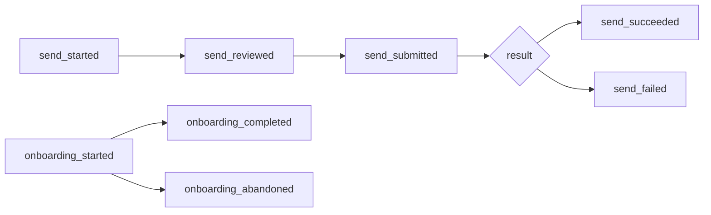

# Analytics event taxonomy

Product analytics for the web and mobile apps (both planned — see
[HACKMD.md](../../HACKMD.md)). This spec fixes **which events exist and which
properties they may carry** before any UI is built, so funnels can be measured
without collecting anything that identifies a wallet or its money.

## Privacy rules

These apply to every event, with no per-event exceptions.

1. **Never send** a Stellar address of any kind — account (`G…`), muxed
   (`M…`) or contract (`C…`) — including truncated or hashed forms. Hashes of
   a public key are reversible by looking the key up on-chain.
2. **Never send** an amount, balance, fee, price, limit or anything derived
   from one (percentages, ranges, "large payment" flags).
3. **Never send** a memo, a transaction hash, an XDR blob, a secret or seed
   phrase, an asset issuer, a contact name, or free text a user typed.
4. Properties are **closed sets only**: an enum, a boolean, or a small integer
   count listed below. No strings outside the listed values.
5. Each install gets a random `install_id` (UUID v4) generated on the device,
   never derived from a key, and reset when the wallet is removed. No
   user or account IDs are joined to it.
6. Analytics is opt-in, and events are dropped client-side while it is off.

A transaction is public on the Stellar ledger forever, so an event carrying an
address or an amount with a timestamp can be matched to one exact
transaction ([Stellar accounts](https://developers.stellar.org/docs/learn/fundamentals/stellar-data-structures/accounts)).
That is why rules 1–3 have no exceptions.

## Common properties

Sent with every event.

| Property | Type | Values |
|----------|------|--------|
| `install_id` | UUID | random per install (rule 5) |
| `platform` | enum | `web`, `ios`, `android` |
| `app_version` | semver | e.g. `1.4.0` |
| `network` | enum | `testnet`, `mainnet` |

## Events

Names are `object_action`, snake case, past tense.

| Event | When | Extra properties |
|-------|------|------------------|
| `onboarding_started` | First screen of wallet setup shown | `method`: `create`, `import` |
| `onboarding_completed` | Wallet usable for the first time | `method`; `backup_done`: boolean |
| `onboarding_abandoned` | Setup left before completing | `step`: `intro`, `backup`, `verify`, `fund` |
| `login_succeeded` | `POST /api/v1/auth/login` returns a JWT | — |
| `login_failed` | Login rejected | `error_code` |
| `send_started` | Send screen opened | `flow`: `direct`, `path_strict_send`, `path_strict_receive`, `contract_spend` |
| `send_reviewed` | Confirm screen reached | `flow`; `is_contact`: boolean |
| `send_submitted` | Transaction submitted to the API | `flow` |
| `send_succeeded` | Submission confirmed | `flow` |
| `send_failed` | Submission rejected or timed out | `flow`; `error_code` |
| `receive_opened` | Receive / QR screen shown | — |
| `multisig_signature_requested` | Partial transaction created (`/wallet/partial-transaction`) | `signers_required`: 1–20 |
| `multisig_submitted` | `/wallet/submit-multisig` called | — |
| `recovery_guardian_added` | `add_guardian` succeeds | `guardian_count`: 1–15 (`MAX_GUARDIANS`) |
| `recovery_initiated` | Guardian calls `initiate_recovery` | `role`: `guardian` |
| `recovery_approved` | `approve_recovery` | `role`: `guardian` |
| `recovery_cancelled` | `cancel_recovery` | `role`: `owner` |
| `recovery_executed` | `execute_recovery` succeeds | `role`: `guardian`, `owner` |
| `spend_limit_hit` | Contract returns `SpendLimitExceeded` | — |

`error_code` is limited to the API's error codes (`VALIDATION_ERROR`,
`PAYLOAD_TOO_LARGE`, `INTERNAL_ERROR`, …) and contract error names (e.g.
`SpendLimitExceeded`). It never contains an error message, which can echo
user input.

## Funnels

Send conversion is `send_succeeded / send_started` per `flow`; the drop
between `send_reviewed` and `send_submitted` measures confirm-screen
hesitation, which the [address display rules](https://github.com/Genghis-codes/Stellar-Global-Wallet/issues/101)
are expected to move.

## Adding an event

1. Add a row above with its trigger and closed-set properties.
2. Check it against the privacy rules in review; anything touching an address
   or an amount is rejected, not anonymized.
